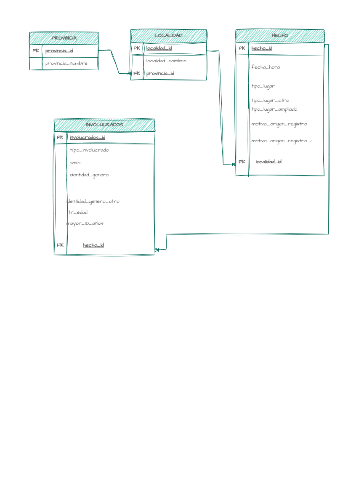

# Análisis de homicidios en Argentina desde 2017 - 2025

En este proyecto se busca responder a las siguientes interrogantes:

1. ¿Cuáles son las tres provincias con mayor **tasa de homicidios** (riesgo poblacional)?
   * De esas provincias principales, ¿cuáles son las localidades más críticas en cuanto a **cantidad de casos** (volumen/focos de conflicto)?

#### A nivel nacional

2. ¿Cuál es el grupo demográfico más vulnerable (sexo, género, edad)?
3. ¿Existen meses o rangos horarios donde los casos se disparan?
4. ¿Los hechos suceden en un domicilio particular o fuera del mismo?
5. ¿Cuál es el TOP 10 de localidades donde sucede una mayor cantidad de femicidios?
6. ¿Cuál es el TOP 5 de las provincias con mayor cantidad de femicidios?
7. ¿Cuál es la tendencia o evolución de los femicidios a lo largo del tiempo (por año)?
8. ¿En qué lugar suceden los femicidios con mayor frecuencia (domicilio particular o fuera del mismo)?

> **Nota:** las preguntas 5 a 8 se basan en `categoria_femicidio`, una clasificación exploratoria que no identifica femicidios confirmados (ver sección *Clasificación exploratoria de femicidios*).

## ETL

Se extraen los datos de https://datos.gob.ar/ 

link: https://datos.gob.ar/dataset/homicidios-dolosos-sistema-de-alerta-temprana-estadisticas-criminales-en-la-republica-argentina

El proceso de ETL y limpieza inicial se realiza con Python.

### Tecnologías:
* **Python (Pandas):** Extracción, limpieza, normalización y estandarización de los datasets.
* **PostgreSQL:** Modelado relacional inicial, diagrama Entidad-Relación y auditoría de calidad de datos (*Data Quality*).
* **Power BI:** Creación del modelo de datos final y desarrollo de la visualización interactiva.

## Diagrama de Entidad-Relación (DER)
Previo al análisis con PostgreSQL se plantea el siguiente diagrama Entidad-Relación para poder estructurar los datos de la mejor manera posible:

## Estructura de Datos (Tablas)
Luego del proceso de ETL, se divide el dataset original en 4 archivos CSV normalizados para su ingesta en la base de datos:

- `provincia.csv`
- `localidad.csv`
- `hecho.csv`
- `involucrados.csv`

### Normalización de Datos (Melt)
Para alinear los datos exactamente con el Diagrama Entidad-Relación, se aplicó una transformación (Melt) sobre la tabla `involucrados`. Se separó a las víctimas y a los inculpados en filas individuales, agregando la columna `tipo_involucrado` y asignando un ID único autoincremental en preparación para SQL.

## Base de Datos y Análisis

Se utilizó **PostgreSQL** con fines exploratorios y de práctica inicial: se planteó un modelo relacional (ver DER) y se auditó la calidad de los datos. Luego se decidió continuar el análisis con **Python y Power BI** sobre el dataset consolidado `homicidios_limpio.csv`.

### Hallazgos de Data Quality

* **`localidad_id` no es una clave única a nivel nacional:** el mismo código puede repetirse en departamentos distintos, por lo que identifica una localidad solo junto con provincia y departamento. Usarlo como clave en un modelo relacional genera cruces erróneos (filas duplicadas). Por eso las localidades se agrupan por provincia y nombre.
* **`id_hecho` se repite en el dataset:** cada fila representa una víctima, por lo que los hechos con más de una víctima aparecen varias veces. Cada fila del dataset limpio es una víctima, y los hechos se cuentan con `id_hecho` únicos.
* **Registros descartados:** se eliminaron 3 víctimas con `localidad_id` nulo.
* **Valores de relleno:** las horas `11:11:11` y `11:11:00` parecen valores de relleno, por lo que la hora se analiza en franjas horarias.

## Clasificación exploratoria de femicidios

El dataset no tiene una variable que identifique femicidios ni permite determinar si un homicidio fue motivado por razones de género. Por eso se creó la columna `categoria_femicidio`, una **clasificación exploratoria** basada en la identidad de género de la víctima (`victima_identidad_genero`) y su vínculo con el inculpado (`victima_relacion_inculpado`).

| Categoría | Criterio |
|---|---|
| **Femicidio íntimo según el vínculo** | Víctima mujer o mujer trans/travesti, con vínculo `Cónyuge/Pareja` o `Ex cónyuge/Ex pareja`. |
| **Posible femicidio familiar** | Víctima mujer o mujer trans/travesti, con vínculo `Hijo/a`, `Padre/Madre`, `Hermano/a` u `Otros vínculos familiares`. |
| **Vínculo sin determinar** | Víctima mujer o mujer trans/travesti, con vínculo `Sin determinación`. |
| **Otro vínculo** | Víctima mujer o mujer trans/travesti, con vínculo no familiar, comercial o `Sin relación`. |
| **No aplica** | Víctima identificada como `Varón` o `Varón trans`. |
| **Identidad de género sin determinar** | Registros cuya identidad de género figura como `Sin determinar`. |

### Limitaciones y uso

* Es una aproximación, no una identificación judicial de femicidios. El vínculo con el inculpado no demuestra por sí solo que exista violencia de género.
* Los casos con vínculo sin determinar pueden incluir situaciones compatibles con femicidio, por lo que los totales deben interpretarse como un **piso** y no como una cifra completa.
* No se verificó el sexo ni el género del inculpado.
* Para el análisis principal se utiliza **Femicidio íntimo según el vínculo** como criterio estricto. Como análisis complementario se incluye **Posible femicidio familiar**, sin que esta ampliación equivalga a femicidios confirmados.

## Integración de Datos Censales y Cálculo de Tasas

En esta etapa se incorporaron datos de población para normalizar las métricas y calcular el riesgo relativo:

* **Fuente de datos:** Se descargaron los datos oficiales de población del Censo 2022 (INDEC - Link: https://www.indec.gob.ar/indec/web/Nivel4-Tema-2-41-165).
* **Limpieza y Estandarización:** Se limpiaron los registros y se normalizaron los nombres de las provincias para asegurar un cruce exacto con la base de homicidios y preparar el modelo relacional para Power BI.
* **Cálculo de Tasa:** Se unieron los dataframes (`homicidios_limpio.csv` y `censo_limpio.xlsx`) para calcular la tasa de homicidios por cada 100.000 habitantes a nivel provincial.
* **Análisis Focalizado:** Se identificó el Top 3 de provincias con la mayor tasa de homicidios, estableciendo el punto de partida para un análisis más profundo a nivel de localidades.

## Estructura de la aplicación (Streamlit)

La aplicación interactiva está organizada en tres módulos principales de análisis:

1. **Panorama General y Tasas Provinciales:** Visualización de métricas clave (total de víctimas y tasa cada 100.000 habitantes por provincia) y mapas de localidades críticas.
2. **Demografía y Ámbito del Hecho:** Comparativa de víctimas según sexo, rangos etarios y distribución del lugar del evento (domicilio particular vs. vía pública).
3. **Análisis de Femicidios y Violencia de Género:** Módulo focalizado en la clasificación exploratoria de femicidios (criterio estricto íntimo y ampliado familiar), vínculos con el inculpado y evolución temporal a lo largo del período 2017-2025.

#### Cómo visualizar el proyecto

* **Exploración interactiva web (Categoría Exploración interactiva):** [Link a la aplicación en vivo en Streamlit](https://6dxutgkf7tuslryrmebhkd.streamlit.app/)
* **Historia visual / Infografía (Categoría Historia visual):** Pieza gráfica de síntesis y concientización sobre la violencia de género a puertas adentro: *«Llegamos a casa, ¿podemos descansar?»* (disponible en la raíz del repositorio como `infografia_violencia.png`).
* **Reporte en Power BI Desktop (.pbix):** en desarrollo

## Declaración de uso de Inteligencia Artificial

Se declara el uso de herramientas de inteligencia artificial en el desarrollo del proyecto.

**Herramientas utilizadas:** Claude (Anthropic), ChatGPT (OpenAI) y Gemini (Google).

**Etapas y finalidad:**
- **Procesamiento de datos:** asistencia en la limpieza y estandarización con Python (Pandas) y en la verificación de problemas de calidad de datos.
- **Código:** asistencia en la refactorización y optimización de scripts (Pandas, Streamlit, Plotly).
- **Diseño del análisis:** discusión de criterios para la clasificación exploratoria de femicidios (`categoria_femicidio`).
- **Documentación:** asistencia en la redacción del README.

**Supervisión y autoría:** la IA asistió en la escritura del código de la aplicación (Streamlit y Plotly) y del procesamiento de datos, siempre bajo supervisión humana. El autor definió las preguntas de análisis, la selección de variables, los tipos de gráfico, el diseño de la experiencia de usuario, y revisó y validó el código y los resultados. No se utilizó IA generativa para crear imágenes ni para generar gráficos de forma automatizada sin intervención humana.